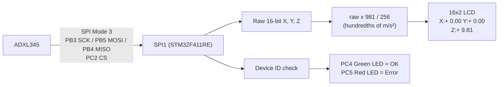

# SPI-Based ADXL345 3-Axis Accelerometer Interfacing with STM32F411RE and 16×2 LCD (Bare-Metal)

**Difficulty Level:** Advanced

A bare-metal STM32 project that reads the X, Y and Z acceleration of an ADXL345 accelerometer over SPI1, converts the raw readings to m/s², and shows them live on a 16×2 character LCD (4-bit mode). The firmware verifies the sensor's device ID at startup and reports the result on a green/red status LED pair. All peripherals (GPIO, SPI1, and the bit-banged LCD interface) are configured through direct register access, with no HAL calls.


---

## Project Overview

This project combines three register-level skills into one system: SPI1 master communication, ADXL345 register access (device-ID check, configuration, multi-byte axis reads), and an LCD driven in 4-bit mode over bit-banged GPIO.

**Data flow**



**Target Users**
- Embedded students learning register-level SPI (master mode, CPOL/CPHA, software NSS) on STM32
- Developers interfacing an ADXL345 or similar SPI sensor without a vendor library
- Anyone building a bit-banged HD44780 LCD driver and wanting a real data source to display

---

## Features

- SPI1 master configured in Mode 3 (CPOL=1, CPHA=1), 8-bit frames, MSB first, software-managed chip select on PC2
- ADXL345 device-ID verification (`0xE5`) at startup, with the observed ID shown on the LCD in hex if it doesn't match
- Full-resolution mode at ±2 g (≈256 LSB/g), measurement mode enabled through `POWER_CTL`
- Multi-byte reads of the X, Y and Z axes (read bit + multi-byte bit set in the address byte)
- Integer-only conversion of raw samples to m/s² (`raw × 981 / 256`, in hundredths), with no floating point
- 16×2 HD44780-compatible LCD driven in 4-bit mode via bit-banged GPIO (no LCD library)
- Fixed-width `±NN.NN` formatting so values never leave stale characters on the display
- SPI timeout protection: a stuck TXE/RXNE/BSY wait sets an error flag instead of hanging forever
- Green/red LED status indication (sensor OK / sensor or SPI fault)

---

## Technologies Used

- **MCU:** STM32F411RE (Nucleo-F411RE), ARM Cortex-M4
- **Language:** Bare-metal C (direct register manipulation, no HAL/LL drivers)
- **Toolchain:** STM32CubeIDE (GCC ARM toolchain, `arm-none-eabi-gcc`)
- **Peripherals:** RCC, GPIOA/B/C, SPI1
- **Sensor:** ADXL345 3-axis digital accelerometer (SPI interface)
- **Display:** 16×2 HD44780-compatible LCD (4-bit interface)

---

## Folder Structure

```
10_SPI_Based_ADXL345_Axis_Accelerometer_Interfacing_with_STM32F411RE_and_16x2_LCD/
├── Src/
│   ├── main.c              # GPIO/SPI1/LCD init, ADXL345 driver, main loop
│   ├── syscalls.c           # Auto-generated syscall stubs
│   └── sysmem.c              # Auto-generated heap management stubs
├── Startup/
│   └── startup_stm32f411retx.s   # Reset handler and vector table
├── STM32F411RETX_FLASH.ld    # Flash linker script
├── STM32F411RETX_RAM.ld       # RAM linker script
├── .project / .cproject        # STM32CubeIDE project files
└── ...Debug.launch              # Debug launch configuration
```

---

## Hardware & Connections

| Component | Purpose |
|---|---|
| STM32 Nucleo-F411RE | Main microcontroller |
| ADXL345 breakout module | 3-axis accelerometer (SPI mode) |
| 16×2 HD44780-compatible LCD | Displays X/Y/Z acceleration |
| 320 Ω resistor | LCD backlight current limiting |
| Potentiometer | LCD contrast (V0) |
| Green LED + resistor | Sensor OK indicator (PC4) |
| Red LED + resistor | Error indicator (PC5) |
| Jumper wires | Connections |

**STM32 → ADXL345 (SPI1)**

| ADXL345 Pin | STM32 Pin | Function |
|---|---|---|
| SCL (SCLK) | PB3 | SPI1_SCK (AF5) |
| SDA (SDI / MOSI) | PB5 | SPI1_MOSI (AF5) |
| SDO (MISO) | PB4 | SPI1_MISO (AF5) |
| CS | PC2 | Chip select (GPIO, software-driven) |
| VCC | 3.3 V | Power |
| GND | GND | Ground |

**STM32 → LCD**

| LCD Pin | STM32 Pin |
|---|---|
| RS | PA8 |
| E | PA9 |
| D4 | PA5 |
| D5 | PA6 |
| D6 | PA11 |
| D7 | PA12 |

**LCD power**

| LCD Pin | Connection |
|---|---|
| VSS | GND |
| VDD | 5 V |
| V0 | Potentiometer wiper |
| A | 5 V through 320 Ω |
| K | GND |

**Status LEDs**

| LED | STM32 Pin | Meaning |
|---|---|---|
| Green | PC4 | ADXL345 detected and responding |
| Red | PC5 | Wrong device ID or SPI timeout |

---

## How It Works

1. `GPIO_Init()` enables the GPIOA, GPIOB and GPIOC clocks; sets PA5, PA6, PA8, PA9, PA11, PA12 as outputs (LCD); sets PB3, PB4, PB5 to alternate function AF5 (SPI1); and sets PC2 (CS), PC4 (green LED), PC5 (red LED) as outputs. CS starts high and both LEDs start off.
2. `SPI1_Init()` enables the SPI1 clock, then configures master mode, Mode 3 (CPOL=1, CPHA=1), a PCLK/32 baud prescaler, 8-bit frames and software slave management, and finally sets `SPE` to enable the peripheral.
3. `LCD_Init()` runs the standard HD44780 4-bit initialization sequence (`0x03 × 3`, `0x02`, then `0x28`/`0x0C`/`0x06`/`0x01`) after a power-up delay.
4. `main()` shows `ADXL345 Starting` / `Checking sensor`, then reads register `0x00` (DEVID). If the ID is `0xE5` and no SPI error occurred, the green LED turns on; otherwise the red LED turns on, the LCD shows `ADXL345 ERROR` with the observed ID in hex, and the firmware halts.
5. The sensor is configured: `DATA_FORMAT = 0x08` (FULL_RES = 1, range = ±2 g), then `POWER_CTL = 0x08` (Measure = 1). A short delay follows and the LCD is cleared.
6. The main loop repeatedly:
   - Reads X, Y and Z with `ADXL345_ReadAxis()` (halting with the red LED if any read hits an SPI timeout).
   - Converts each raw value with `Accel_ToHundredthsMps2()`.
   - Prints `X:` and `Y:` on line 1 and `Z:` on line 2 using `LCD_PrintAcceleration()`.
   - Delays (`delay(100000)`) before repeating.

**SPI transaction format (ADXL345)**

```
Byte 0 (command):  [R/W][MB][A5..A0]
                    R/W = 1 for read, 0 for write
                    MB  = 1 for multi-byte (auto-increment address)

Read register:     CS low → (addr | 0x80) → dummy 0x00 → value → CS high
Write register:    CS low → (addr & 0x3F) → value → CS high
Read axis:         CS low → (addr | 0xC0) → dummy → LSB → MSB → CS high
```

Each axis is a 16-bit two's-complement value split across two consecutive registers (`DATAx0` = low byte, `DATAx1` = high byte). Because the multi-byte bit is set, the address auto-increments and both bytes arrive in one transaction.

**Unit conversion**

In full-resolution mode the ADXL345 gives about 256 LSB per g, so:

```
acceleration (m/s², hundredths) = raw × 9.81 / 256 × 100 = raw × 981 / 256
```

Using integer math in hundredths of m/s² avoids pulling in floating-point support. For example, a raw value of 256 (1 g) becomes 981, displayed as `+ 9.81`.

**LCD layout**

```
Column:  1 2 3 4 5 6 7 8 9 10 11 12 13 14 15 16
Line 1:  X : + 0 . 0 0 _ _ Y  :  +  0  .  0  0   (example)
Line 2:  Z : + 9 . 8 1
```

Each value is six characters: sign, tens digit (a space if zero), ones digit, decimal point, and two fractional digits.

---

## Code Explanation (Register-Level)

**RCC**

| Register | Bit(s) | Field | Value | Purpose |
|---|---|---|---|---|
| AHB1ENR | 0 | GPIOAEN | 1 | Enables GPIOA clock |
| AHB1ENR | 1 | GPIOBEN | 1 | Enables GPIOB clock (SPI1 pins) |
| AHB1ENR | 2 | GPIOCEN | 1 | Enables GPIOC clock (CS and LEDs) |
| APB2ENR | 12 | SPI1EN | 1 | Enables SPI1 clock |

**GPIOA / GPIOB / GPIOC**

| Register | Bit(s) | Field | Value | Purpose |
|---|---|---|---|---|
| GPIOA_MODER | [11:10] | MODER5 | 01 | PA5 = Output (LCD D4) |
| GPIOA_MODER | [13:12] | MODER6 | 01 | PA6 = Output (LCD D5) |
| GPIOA_MODER | [17:16] | MODER8 | 01 | PA8 = Output (LCD RS) |
| GPIOA_MODER | [19:18] | MODER9 | 01 | PA9 = Output (LCD E) |
| GPIOA_MODER | [23:22] | MODER11 | 01 | PA11 = Output (LCD D6) |
| GPIOA_MODER | [25:24] | MODER12 | 01 | PA12 = Output (LCD D7) |
| GPIOB_MODER | [7:6] | MODER3 | 10 | PB3 = Alternate Function (SPI1_SCK) |
| GPIOB_MODER | [9:8] | MODER4 | 10 | PB4 = Alternate Function (SPI1_MISO) |
| GPIOB_MODER | [11:10] | MODER5 | 10 | PB5 = Alternate Function (SPI1_MOSI) |
| GPIOB_AFRL | [15:12] | AFSEL3 | 0101 | PB3 → AF5 (SPI1_SCK) |
| GPIOB_AFRL | [19:16] | AFSEL4 | 0101 | PB4 → AF5 (SPI1_MISO) |
| GPIOB_AFRL | [23:20] | AFSEL5 | 0101 | PB5 → AF5 (SPI1_MOSI) |
| GPIOC_MODER | [5:4] | MODER2 | 01 | PC2 = Output (ADXL345 CS) |
| GPIOC_MODER | [9:8] | MODER4 | 01 | PC4 = Output (green LED) |
| GPIOC_MODER | [11:10] | MODER5 | 01 | PC5 = Output (red LED) |
| GPIOA_ODR | 5, 6, 11, 12 | ODR | data | LCD D4, D5, D6, D7 |
| GPIOA_ODR | 8 | ODR8 | 0 / 1 | LCD RS: 0 = command, 1 = data |
| GPIOA_ODR | 9 | ODR9 | pulsed | LCD E: enable pulse per nibble |
| GPIOC_ODR | 2 | ODR2 | 0 / 1 | ADXL345 CS (active low) |

**SPI1**

| Register | Bit(s) | Field | Value | Purpose |
|---|---|---|---|---|
| CR1 | 0 | CPHA | 1 | Second clock edge captures data (Mode 3) |
| CR1 | 1 | CPOL | 1 | Clock idles high (Mode 3) |
| CR1 | 2 | MSTR | 1 | Master mode |
| CR1 | [5:3] | BR | 100 | Baud rate = PCLK / 32 |
| CR1 | 6 | SPE | 1 | SPI enabled (set last, cleared during configuration) |
| CR1 | 7 | LSBFIRST | 0 | MSB first |
| CR1 | 8 | SSI | 1 | Internal slave select high (keeps master mode valid) |
| CR1 | 9 | SSM | 1 | Software slave management |
| CR1 | 11 | DFF | 0 | 8-bit data frame |
| SR | 0 | RXNE | polled | Receive buffer not empty (byte received) |
| SR | 1 | TXE | polled | Transmit buffer empty (ready for next byte) |
| SR | 7 | BSY | polled | SPI busy, checked before releasing CS |
| DR | [7:0] | DATA | — | Accessed as an 8-bit register to force 8-bit transfers |

**ADXL345 registers**

| Register | Address | Value written/read | Purpose |
|---|---|---|---|
| DEVID | 0x00 | reads `0xE5` | Device identification check |
| POWER_CTL | 0x2D | `0x08` | Measure bit = 1, starts measurement |
| DATA_FORMAT | 0x31 | `0x08` | FULL_RES = 1, range = ±2 g |
| DATAX0 | 0x32 | read 2 bytes | X-axis low/high byte |
| DATAY0 | 0x34 | read 2 bytes | Y-axis low/high byte |
| DATAZ0 | 0x36 | read 2 bytes | Z-axis low/high byte |

---

## Error Handling & Design Notes

**SPI timeouts:** every wait loop in `SPI1_TransferByte()` and `SPI1_WaitBusy()` counts down from `SPI_TIMEOUT` (100000). If a flag never sets, the function sets the global `spi_error` flag and returns instead of blocking forever. Each ADXL345 access clears `spi_error` first, checks it afterward, and returns 0 on failure.

**Device-ID check before configuration:** reading `DEVID` and comparing it with `0xE5` catches the most common bring-up problems (wrong SPI mode, swapped MISO/MOSI, missing CS, no power) before any configuration is attempted. On failure, the LCD displays the ID it actually received in hex, which makes the fault easier to diagnose.

**Waiting for BSY before raising CS:** `SPI1_WaitBusy()` is called after the last byte of each transaction so CS is not released while the final clock cycles are still being shifted out.

**Explicit 8-bit data register access:** `SPI1_DR8` is declared as a `volatile uint8_t *` so reads and writes of `DR` are single 8-bit accesses rather than 16-bit, which keeps frames at 8 bits and avoids accidentally pushing an extra byte.

**Fixed-width LCD output:** `LCD_PrintAcceleration()` always prints exactly six characters, using a space in place of a leading zero in the tens digit. Because the field width never changes, a shorter value cleanly overwrites a longer one without leaving old characters behind.

**Status LEDs:** the green LED confirms the sensor responded with the correct ID; the red LED indicates a wrong ID or an SPI timeout at any point, after which the firmware halts.

---

## Installation

1. Install [STM32CubeIDE](https://www.st.com/en/development-tools/stm32cubeide.html).
2. Clone the repository:
   ```bash
   git clone https://github.com/anshukumar146/STM32F411RE-Bare-Metal-Projects.git
   ```
3. In STM32CubeIDE, go to **File → Open Projects from File System** and import:
   ```
   10_SPI_Based_ADXL345_Axis_Accelerometer_Interfacing_with_STM32F411RE_and_16x2_LCD
   ```

---

## Running

1. Connect the Nucleo-F411RE board via USB (onboard ST-Link).
2. Build the project: **Project → Build Project**.
3. Flash and run: **Run → Debug** (or **Run**).

---

## Usage

1. Wire the ADXL345 to PB3 (SCL), PB4 (SDO), PB5 (SDA), PC2 (CS), 3.3 V and GND.
2. Wire the LCD per the pin mapping above, and the two status LEDs to PC4 and PC5.
3. Power on the board. The LCD briefly shows `ADXL345 Starting` / `Checking sensor`, and the green LED lights if the sensor is detected.
4. The LCD then shows live X and Y values on line 1 and Z on line 2, in m/s². With the board lying flat, Z should read about `+ 9.81` and X/Y near zero. Tilting the board shifts gravity between the axes.
5. If the red LED lights and the LCD shows `ADXL345 ERROR`, check wiring, the SPI mode and the CS line.

---

## Schematic

<!-- Add your schematic image / PDF link here -->

---

## Screenshots


---
## pulse view


---
## Demo Video


https://github.com/user-attachments/assets/9a1af649-e879-4702-920a-e36cef2dd26d


---

## Results

| Test | Result |
|---|---|
| SPI1 master configuration (Mode 3, PCLK/32, software NSS) | Working |
| ADXL345 device-ID read (`0xE5`) | Working |
| Full-resolution ±2 g configuration and measurement mode | Working |
| X, Y, Z multi-byte reads | Working |
| Integer conversion to m/s² (`raw × 981 / 256`) | Working |
| LCD 4-bit init and live acceleration display | Working |
| Green/red LED status and error screen | Working |

---

## Future Improvements

- Replace the busy-wait `delay()` calls with a timer-based delay
- Use ADXL345's data-ready interrupt (INT1) instead of polling at a fixed interval
- Add calibration using the ADXL345 offset registers (`OFSX`, `OFSY`, `OFSZ`)
- Compute tilt angles (roll/pitch) from the three axes and show them on the LCD
- Retry or recover from an SPI error instead of halting
- Move the LCD driver into a small reusable bare-metal HD44780 library
- Replace polling with SPI interrupts or DMA

---

## Learning Outcomes

**STM32:** GPIO clock enabling across multiple ports, GPIO output/alternate-function configuration (AFRL), SPI1 master setup (CPOL/CPHA, baud prescaler, software NSS, SPE ordering), TXE/RXNE/BSY flag handling, bit-banged HD44780 4-bit LCD driving.

**Sensor interfacing:** SPI read/write command format, multi-byte burst reads, device-ID verification, full-resolution mode, converting raw LSB counts to physical units with integer math, assembling a signed 16-bit value from two bytes.

**Embedded C:** `volatile`, pointer-based register access, 8-bit vs 32-bit register access widths, bit manipulation and masking, fixed-width integer types, timeout-guarded polling loops.

**Hardware debugging:** Using a device-ID read as the first sanity check for a new SPI sensor, using LEDs and an error screen for fault indication, and handling timeouts so a missing device doesn't hang the firmware.

---

## Skills Demonstrated

- Bare-Metal STM32 Register Programming (RCC, GPIO, SPI1)
- SPI Master Communication and Sensor Driver Development (ADXL345)
- Bit-Banged HD44780 LCD Driving (4-bit mode)
- Fixed-Point / Integer Unit Conversion
- Defensive Firmware Design (timeouts, ID check, fault indication)
- Technical Documentation

---

## Author

**Anshu Kumar**
GitHub: [@anshukumar146](https://github.com/anshukumar146)

---

## License

This project is licensed under the MIT License. Note that `startup_stm32f411retx.s` and the `.ld` linker scripts are STM32CubeIDE/STMicroelectronics-generated boilerplate, licensed under terms provided by STMicroelectronics (see the file headers).

```
MIT License

Copyright (c) 2026 Anshu Kumar

Permission is hereby granted, free of charge, to any person obtaining a copy
of this software and associated documentation files (the "Software"), to deal
in the Software without restriction, including without limitation the rights
to use, copy, modify, merge, publish, distribute, sublicense, and/or sell
copies of the Software, and to permit persons to whom the Software is
furnished to do so, subject to the following conditions:

The above copyright notice and this permission notice shall be included in all
copies or substantial portions of the Software.

THE SOFTWARE IS PROVIDED "AS IS", WITHOUT WARRANTY OF ANY KIND, EXPRESS OR
IMPLIED, INCLUDING BUT NOT LIMITED TO THE WARRANTIES OF MERCHANTABILITY,
FITNESS FOR A PARTICULAR PURPOSE AND NONINFRINGEMENT. IN NO EVENT SHALL THE
AUTHORS OR COPYRIGHT HOLDERS BE LIABLE FOR ANY CLAIM, DAMAGES OR OTHER
LIABILITY, WHETHER IN AN ACTION OF CONTRACT, TORT OR OTHERWISE, ARISING FROM,
OUT OF OR IN CONNECTION WITH THE SOFTWARE OR THE USE OR OTHER DEALINGS IN THE
SOFTWARE.
```

---

## Acknowledgements

- STM32F411RE Reference Manual (RM0383) and Datasheet, STMicroelectronics
- ADXL345 Datasheet, Analog Devices
- HD44780 LCD controller datasheet
- STM32CubeIDE documentation
